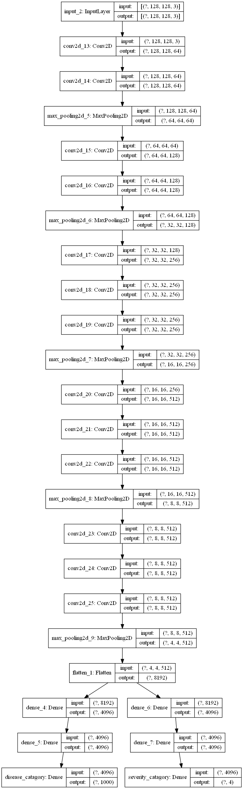
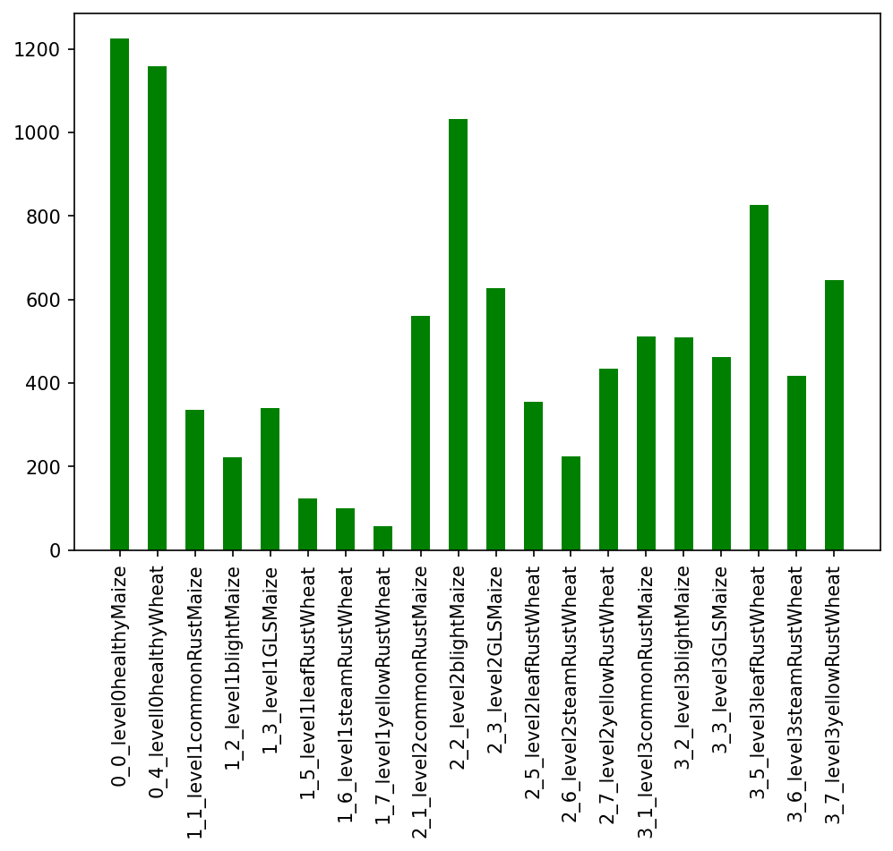

# Image-Based Crop Disease and Severity Classification Using CNN

MSc thesis code (Adama Science and Technology University, 2022). A single CNN that looks at a wheat or maize leaf image and predicts **both the disease type and its severity level** (multi-label classification).

## Model
- Modified **VGG16** combined with a pair of **channel shuffle (ShuffleNet-style) blocks**.
- Two outputs from one model: disease type and severity level, which saves compute compared with training two separate models.
- Trained with the Adam optimizer, with dropout and L1/L2 regularization tested for generalization.



*VGG16 baseline with separate disease and severity heads.*

## Dataset (not included)
- Wheat and maize leaves: healthy plus three diseases per crop, each with three severity levels (early, middle, severe).
- 11,467 images collected, 9,518 after cleaning, resized to 128×128 and split 80:10:10 (train / validation / test).
- About 65% of the data came from research centers; the rest came from private sources, laboratory images and manual field capture.
- Augmentation (rotation, translation, flips, shear) was used to balance the classes.



## Result
About **0.98 accuracy** for both disease and severity classification, with lower computational cost than plain VGG16.

## Notebooks
| File | What it does |
|------|--------------|
| `notebooks/multilabel_training_Test1.ipynb` | **Main notebook:** data loading, class plots, ShuffleNet blocks, final model and training |
| `notebooks/VGG16_pure_Functional_Api.ipynb` | VGG16 two-output baseline |
| `notebooks/image_augmentation.ipynb` | Image augmentation |
| `notebooks/CH5_implimentation.ipynb` | K-fold and evaluation (confusion matrix, classification report); code fragments |
| `notebooks/bar_graph.ipynb` | Class distribution plot |

## Run it
```
pip install tensorflow numpy pandas matplotlib seaborn plotly scikit-image opencv-python pillow
jupyter notebook
```
Start with the main notebook. The notebooks use paths from my own computer (`C:/Users/...`), so change the dataset path to your own copy of the images.

## Tools
Python, TensorFlow 2 / Keras, Jupyter Notebook and Google Colab.

## Thesis
*Image-Based Crop Disease and Severity Classification Using Convolutional Neural Network*, Mahder Demeke Desalegn, advisor Prof. Yun Koo Chung, September 2022.
